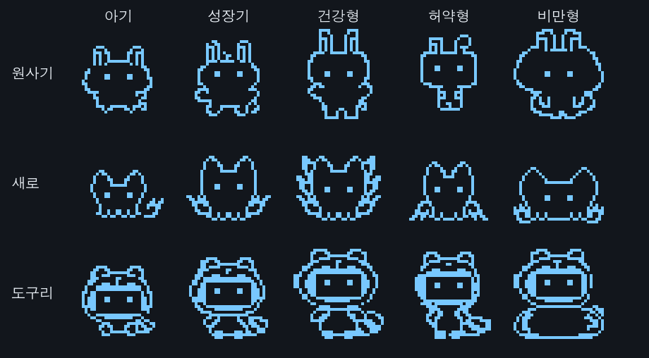

# 해빗치 (Habitchi)

> **생활습관을 함께 돌보는 피지컬 다마고치**
> 오래 앉아 있는 만큼, 그 시간을 책임져 주는 책상 위 다마고치 — "내가 건강해야 펫도 건강하다"

부산대학교 정보컴퓨터공학부 「어드벤처디자인」 003분반 텀 프로젝트 · Team **마녀와 야수들** (문보미 · 김도훈 · 조채원)

해빗치는 Arduino Mega 2560으로 만든 책상 위 펫이에요. 단순히 버튼으로 입력하는 대신, 센서와 PC가 **실제로 측정한 수면 환경과 코딩 습관**에 따라 펫이 자라고, 아프고, 진화해요. 펫의 밥은 내 **git 커밋**이에요.

## 기능
| 습관 | 측정 | 펫의 반응 | 구분 |
|---|---|---|---|
| 수면 환경 | 소등·기상 시각(조도 + RTC), 밤사이 소음(사운드 센서), 방 온도(LM35)<br>(확장) 불 끈 뒤 화면 불빛 — 파란 LED를 빛 센서로 | 제때 자면 함께 잠들고 회복, 기상 알람, 시끄러우면 잠을 설침, 추운 방에서 자면 감기 | 필수·확장 |
| 코딩 습관 | 어두운 데서 코딩(조도 + PC), 연속 코딩 시간, 취침 후 커밋·키보드<br>(확장) 폰 거치대(압력 + 피에조 진동), 물병 수위(호일 정전용량) | 눈 아파함, 50분마다 "스트레칭하자!", 밤샘하면 졸려하고 경험치가 적게 쌓임 | 필수·확장 |
| 식사 = 커밋 | 커밋 메시지 분류 + 커밋 시각·간격<br>(확장) 테스트·빌드 결과 | 건강식·정크푸드·야식(달빛 야식 → 체한 표정)·배탈 | 필수·확장 |
| 운동 | 운동 전후 심박 | 실제로 심박이 오르면 체력 상승 | 확장 |

- **펫:** 포만감·수면·체력·경험치 / 알 → 아기 → 성장기 → 건강형·허약형·비만형

원사기·새로·도구리는 알이 깰 때 같은 확률로 뽑혀요. 캐릭터별 몸 그림은 성장 단계에 따라 바뀌고, 감정은 공용 표정과 효과로 표현해요.



- **아픔과 죽음:** 감기·수면 부족·굶주림·과로로 아픈 채 1일이 지나면 죽고, 알로 다시 시작해요(이전 펫은 기록).
- **판단은 아두이노가** PC는 "커밋했다", "키보드를 치고 있다" 같은 사실만 보내요.

## 폴더
| 폴더 | 내용 |
|---|---|
| [`firmware/habitchi/`](firmware/habitchi) | 아두이노 본 코드 (`habitchi.ino`를 Arduino IDE로 열기) |
| [`firmware/tests/`](firmware/tests) | 부품 하나씩 시험하는 스케치 9개 |
| [`pc/`](pc) | PC 프로그램 (파이썬): 시리얼 브리지, 키보드 감지, 커밋 훅, 대시보드 |
| [`docs/`](docs) | 설명서 (아래 표) |

## 설명서
| 문서 | 내용 |
|---|---|
| [ARCHITECTURE.md](docs/ARCHITECTURE.md) | 코드 구조, 담당 나누기, 코드 규칙 — **처음에 읽기** |
| [wiring.md](docs/wiring.md) | 전체 배선, 조립 순서, 꽂기 전 점검 목록 |
| [sensors.md](docs/sensors.md) | 센서 7종 배선·시험·보정 |
| [clock_input.md](docs/clock_input.md) | RTC 시계, 버튼, 시연 모드 |
| [display_sound.md](docs/display_sound.md) | OLED 화면, 캐릭터 그림 바꾸기, 효과음 |
| [pet.md](docs/pet.md) | 펫 규칙, 설정값, 시연 순서 |
| [pc.md](docs/pc.md) | PC 프로그램 설치·실행, git 훅, 대시보드 |
| [protocol.md](docs/protocol.md) | PC ↔ 아두이노 통신 형식 |

## 시작하기
### 1. 아두이노
1. Arduino IDE의 라이브러리 관리자에서 **U8g2**, **RTClib**, **CapacitiveSensor**를 설치해요.
2. `firmware/habitchi/habitchi.ino`를 열어요. 같은 폴더의 파일들이 탭으로 함께 열려요.
3. 보드는 **Arduino Mega or Mega 2560**, 포트는 USB 포트로 고르고 업로드해요.
4. 배선은 [wiring.md](docs/wiring.md)의 순서대로 한 부품씩 꽂고, `firmware/tests/`의 시험 스케치로 확인해요.

### 2. PC 프로그램
```bash
python3 -m pip install --user -r pc/requirements.txt
python3 pc/habitchi_pc.py
```
- 키보드 감지에는 macOS **손쉬운 사용** 권한이 필요해요. 어떤 키를 눌렀는지는 저장하지 않고 **누른 시각만** 써요.
- 커밋을 펫의 밥으로 쓰려면 내 저장소에 훅을 설치해요: `python3 pc/install_hook.py <저장소 경로>`
- 자세한 내용은 [pc.md](docs/pc.md)를 봐요.

## 버튼
| 버튼 | 짧게 | 길게 |
|---|---|---|
| A | 화면 전환 (펫 ↔ 수치) | 시연 모드 켜기/끄기 |
| B | 시연 모드에서 +1시간 | 운동 시작/끝 |
| C | 시연 모드에서 +10분 | 폰 두기 모드 켜기/끄기 |

시연 모드에서는 시간이 60배 빨리 흘러요. PC 브리지 터미널에 `stage child`, `sick cold`, `die`, `evolve`를 입력하면 진화·아픔·죽음을 바로 보여 줄 수 있어요.

## 하드웨어
Arduino Mega 2560, 0.96" OLED (SSD1306, I2C), DS3231 RTC, 고감도 사운드 센서(LM386), LM35 온도센서, CdS 조도센서, 피에조 2개(소리·진동 감지), FSR 압력센서, 파란 LED, 알루미늄 호일 + 1MΩ, 펄스(심박) 센서, 버튼 3개, 케이스 BB161
