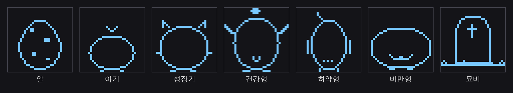
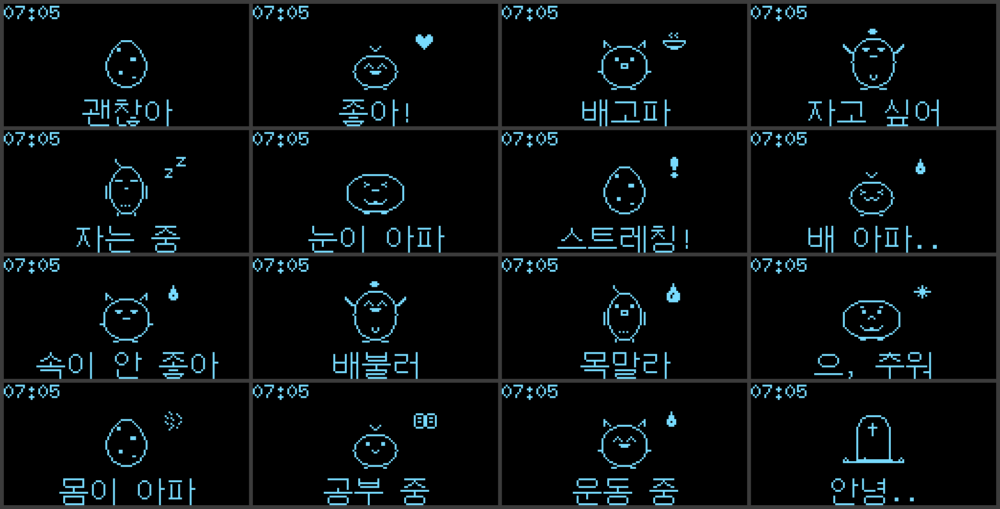
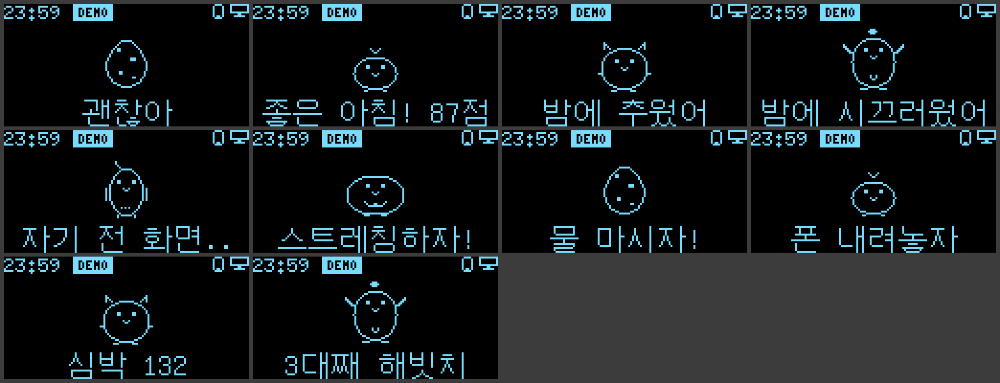
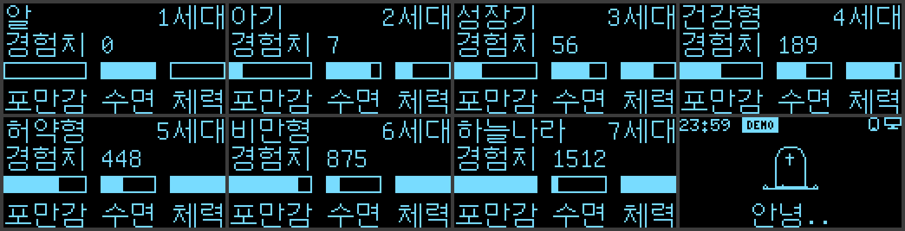
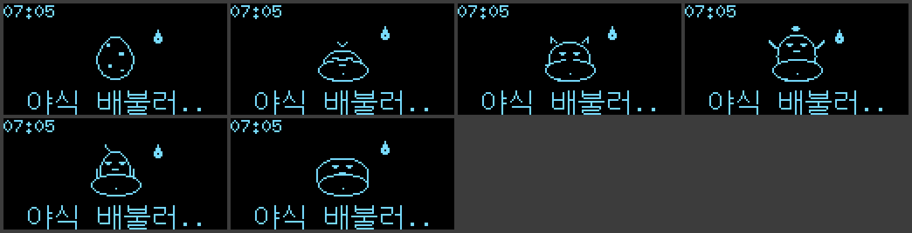

# 화면·소리 패키지 설명서

OLED 화면에 펫을 그리고, 피에조로 효과음을 내는 부분이에요.

| 파일 | 하는 일 |
|---|---|
| `firmware/habitchi/Display.cpp` | 화면 두 장(펫 화면, 상태 화면)을 그려요 |
| `firmware/habitchi/Sprites.h` | 펫 그림, 표정, 효과 아이콘, 상단 아이콘 (임시 그림) |
| `firmware/habitchi/DisplayTexts.h` | 화면에 나오는 한글 문구 전부 |
| `firmware/habitchi/DisplayGlyphs.h` | 글꼴에 없는 한글 글자 10개를 그림으로 넣은 것 |
| `firmware/habitchi/Sound.cpp` | 효과음 10가지를 `loop()`를 막지 않고 재생해요 |
| `firmware/tests/oled_sound/` | 화면과 스피커만 따로 확인하는 시험 스케치 |

## 0. 화면 미리보기
> 실제 OLED가 아니라 PC에서 같은 코드로 그려 본 그림이에요. 캐릭터는 **임시 그림**이고, 팀이 그린 그림으로 바꿀 거예요 (6장 참고).

**성장 단계 그림 (`Sprites.h`, 32×32)**



**기분별 화면 (1쪽)**



**알림 문구 (1쪽 아래 줄)**: 미리보기를 만든 뒤에 운동 결과는 "심박 +N"으로, 측정 실패 알림 "다시 재 줘"가 추가됐어요.



**상태 화면 (2쪽)과 묘비**



**야식 커밋 (배 볼록)**



## 1. 배선

### OLED (0.96" SSD1306, I2C)
| OLED 핀 | 메가 | 메모 |
|---|---|---|
| VCC | 5V 또는 3.3V | 모듈 뒷면 표시를 확인해요. "3.3V-5V"라고 적혀 있으면 5V에 꽂아도 돼요. 3.3V 전용이라고 적혀 있으면 3.3V에 꽂아요 |
| GND | GND | |
| SDA | 20 (SDA) | |
| SCL | 21 (SCL) | |

- 주소는 **0x3C**예요. 모듈 뒷면 저항 위치에 따라 0x3D인 것도 있어요 (아래 문제 해결 참고).
- RTC(DS3231)와 **같은 SDA·SCL 선을 같이 써요.** 브레드보드에서 SDA끼리, SCL끼리 한 줄에 모아 꽂으면 돼요. 두 모듈 주소가 달라서(0x3C, 0x68) 서로 부딪히지 않아요.
- I2C 선은 짧을수록 좋아요. 30 cm 안쪽으로 해요.

### 설치 위치
- 케이스 **뚜껑의 창**에 화면이 보이게 붙여요. 화면 유리 테두리만 뚜껑에 닿게 하고, 뒤쪽 핀은 글루건으로 커넥터만 고정해요 (화면 유리에 글루가 닿으면 깨질 수 있어요).
- 뚜껑을 열 때 선이 빠지지 않게 선 길이에 여유를 두고 케이블 타이로 묶어요.

### 피에조 스피커
| 피에조 | 메가 |
|---|---|
| 한쪽 다리 (+ 표시가 있으면 그쪽) | A3 (`Pins::SPEAKER`) |
| 다른 쪽 다리 | GND |

- 키트에 들어 있는 **수동형(passive) 피에조**를 써요. `tone()`으로 음 높이를 바꿔요.
- 키트 피에조가 **두 개**인데, 다른 하나는 폰 거치대의 **진동 센서**(A5, 1 MΩ 병렬)로 써요. 두 개가 똑같이 생겼으니 **마스킹 테이프에 "소리", "진동"이라고 써서 붙여** 두세요. 바꿔 꽂으면 소리가 안 나고 진동 감지도 안 돼요.
- `tone()`은 Timer2를 써요. Timer2를 쓰는 라이브러리는 같이 쓰면 안 돼요 (ARCHITECTURE.md 규칙 6).

## 2. 화면 구성

### 1쪽: 펫 화면 (기본)
```
┌────────────────────────────┐
│07:05 [DEMO]          ▯ 🖥  │  ← 위쪽 줄: 게임 시각, 시연 배지, 폰 모드, PC 연결
│                            │
│          (펫 그림)    ♥     │  ← 가운데: 32×32 펫 + 표정 + 효과 아이콘
│                            │
│       좋은 아침! 87점       │  ← 아래쪽 줄: 알림 문구, 없으면 기분 한마디
└────────────────────────────┘
```
- 시각은 `GameClock::hour()`, `GameClock::minute()`예요. 시연 모드면 가상 시각이 나와요.
- `GameClock::demoMode()`면 검은 글씨 "DEMO" 배지가 떠요. 위쪽 줄은 높이가 9픽셀뿐이라 16픽셀 한글 "시연"은 들어가지 않아서 영어로 했어요.
- `facts.pcConnected`면 오른쪽 끝에 모니터 아이콘, `Pet::view().phoneMode`면 그 왼쪽에 폰 아이콘이 떠요.
- 단계가 `Dead`면 묘비 그림이 나와요.

### 2쪽: 상태 화면
```
┌────────────────────────────┐
│건강형                 3세대 │
│경험치 1234                  │
│[■■■■   ] [■■  ]  [■■■ ]    │
│ 포만감     수면     체력    │
└────────────────────────────┘
```
- 막대는 0~100이에요. 100보다 큰 값이 와도 100으로 그려요.
- 단계 이름: 알, 아기, 성장기, 건강형, 허약형, 비만형, 하늘나라(죽음).

### 쪽 넘기기
- `Display::nextPage()`를 부르면 1쪽 ↔ 2쪽이 바뀌어요. 어느 버튼에 연결할지는 입력 패키지가 정해요.
- 2쪽은 **10초** 뒤에 저절로 1쪽으로 돌아가요 (`STATS_PAGE_MS`).

### 기분(Mood)마다 보이는 모습
표정은 몸 그림 위에 겹쳐 그리고, 효과 아이콘은 펫 오른쪽 위에 떠요. 움직임은 0.5초마다 두 장면을 번갈아 보여 줘요.

| Mood | 표정 | 효과 아이콘 | 움직임 | 아래 문구 |
|---|---|---|---|---|
| Normal | 보통 | 없음 | 위아래 살짝 | 괜찮아 |
| Happy | 웃음 (^ ^) | 하트 | 점프 | 좋아! |
| Hungry | 입 벌림 | 밥그릇 | 위아래 살짝 | 배고파 |
| Sleepy | 반쯤 감은 눈 | 없음 | 가만히 | 자고 싶어 |
| Sleeping | 감은 눈 | Zzz | 가만히 | 자는 중 |
| SoreEyes | > < 눈 | 없음 | 위아래 살짝 | 눈이 아파 |
| Stretch | 보통 | ! | 점프 | 스트레칭! |
| Stomachache | > < 눈 + 꼬인 입 | 땀방울 | 덜덜 떨기 | 배 아파.. |
| Indigestion (야식) | 반쯤 감은 눈 + **볼록 나온 배** | 땀방울 | 가만히 | 야식 배불러.. |
| Full | 웃음 | 없음 | 가만히 | 배불러 |
| Thirsty | 입 벌림 | 물방울 | 위아래 살짝 | 목말라 |
| Cold | 찡그림 | 눈송이 | 덜덜 떨기 | 으, 추워 |
| Sick | X 눈 | 재채기 | 가만히 | 몸이 아파 |
| Studying | 보통 | 책 | 가만히 | 공부 중 |
| Exercising | 웃음 | 땀방울 | 점프 | 운동 중 |
| Dead | (묘비) | 없음 | 가만히 | 안녕.. |

- Indigestion일 때는 몸 아래쪽을 지우고 둥근 배(타원)를 덧그려서 잠깐 "배 볼록" 모습이 돼요. 기분이 바뀌면 바로 원래 몸으로 돌아와요. 비만형(영구 단계)과는 다른, 그 순간의 모습이에요. 배 위치와 크기는 `Display.cpp`의 `BELLY_CENTER_Y`, `BELLY_RADIUS_X`, `BELLY_RADIUS_Y`예요 (펫 그림 왼쪽 위 기준 픽셀).
- 알 단계는 표정이 없어요. 대신 좌우로 살짝 흔들리고, 효과 아이콘과 문구는 그대로 나와요.

### 알림(Notice) 문구
알림이 `None`이 아니면 기분 문구 대신 알림 문구가 나와요.

| Notice | 문구 | 숫자 |
|---|---|---|
| GoodMorning | 좋은 아침! N점 | `noticeValue` (수면 점수) |
| ColdNight | 밤에 추웠어 | |
| NoisyNight | 밤에 시끄러웠어 | |
| ScreenBeforeSleep | 자기 전 화면.. | |
| StretchNow | 스트레칭하자! | |
| DrinkWater | 물 마시자! | |
| PhoneDown | 폰 내려놓자 | |
| ExerciseResult | 심박 +N (상승폭, `EXERCISE_SHOW_RISE`가 false면 운동 후 심박) | `noticeValue` (심박수) |
| MeasureAgain | 다시 재 줘 | (심박 측정 실패) |
| NewGeneration | N대째 해빗치 | `generation` |

- **펫 패키지와의 약속:** GoodMorning과 ExerciseResult를 띄울 때는 `noticeValue`에 보여 줄 숫자를 넣어 줘야 해요. NewGeneration은 `generation`을 그대로 써요. 알림을 언제 지울지는 펫 패키지가 정해요 (화면은 `notice`가 바뀌면 바로 다시 그려요).

## 3. 화면 갱신 방식 (loop를 막지 않게)
- 0.1초마다 지금 보여 줄 내용(쪽, 애니메이션 장면, 시각, 아이콘, `Pet::view()` 전체)을 모아서 **지난번과 같으면 아무것도 안 해요.**
- 달라졌으면 화면 메모리(1 KB)에 새로 그리고, OLED로는 **한 번의 `update()`에 8줄 중 1줄(128바이트)만** 보내요. 한 줄 보내는 데 약 3~4 ms라서 다른 센서가 오래 기다리지 않아요. 8번의 `loop()`가 지나면 화면 전체가 바뀌어요.
- 펫 화면은 애니메이션 때문에 1초에 2번, 상태 화면은 값이 바뀔 때만 다시 그려요.
- U8g2 **전체 버퍼 모드**(`_F_`)를 써요. 화면 메모리 1 KB를 RAM에 두지만 메가는 RAM이 8 KB라 괜찮아요. 화면·소리 패키지가 쓰는 RAM은 모두 합쳐 약 1.4 KB예요.

## 4. 한글 글꼴

### 쓰는 글꼴
- 한글은 U8g2의 `u8g2_font_unifont_t_korean1` (16픽셀, 약 16 KB)을 써요.
- `u8g2_font_unifont_t_korean2`(글자가 더 많은 것)는 77 KB라서 U8g2가 **AVR(메가)에서는 아예 빼 놓았어요.** 그래서 korean1만 쓸 수 있어요.
- korean1에는 자주 쓰는 한글 **478자**만 있어요. **없는 글자는 화면에 아무것도 안 나오고 빈칸 없이 사라져요.**
- 글꼴에 없는데 꼭 필요한 11자(허 포 칭 빗 폰 박 에 웠 끄 워 줘)는 같은 글꼴 모양 그대로 16×16 그림으로 만들어서 `DisplayGlyphs.h`에 넣었어요. 화면 코드가 이 글자를 만나면 글꼴 대신 이 그림을 그려요.
- 숫자와 영어도 같은 글꼴로 그려요 (한 글자 폭 8픽셀). 위쪽 시각은 작은 영문 글꼴(`u8g2_font_6x10_tr`)이에요.

### korean1에 있는 글자 (478자)
```
가각간갈감갑값강갖같개거건걷걸겁것게겨격겪견결경계고곧곳공과관광괜교구국군굴귀규
그극근글금기길깊까깝깨꺼께껴꼭꽃꾸꿈뀌끌끔끝끼낌나난날남낮낳내냥너넓넘넣네녀녁년
녕노놀놈농높놓누눈눕뉴느는늘능늦니님다닦단달닭담답당대더던데도독돈돌동되두둘뒤듀
드든듣들듯등디따딸땅때떠떤떨떻또뜻라람랑랗래램러런럼럽렇레려력련렵령례로론롭롯료
루룹류륭르른름리린림마막만많말맙맛맞맡매머먹먼멀메며면명몇모목몸못무문묻물뭐미민
믿및밑바밖반받발밝밤밥방배버번벌법벽변별병보본봄부분불붙브비빛빠빨빼뿐쁘사산살삶
삼상새생서석선설섭성세센셈소속손송쇠수순술숲쉐쉬쉽스슨슴습슷시식신실싫심싶싸쌀써
쓰씀씨씬씻아악안앉않알앙앞애야약양얘어억언얻얼엄업없엇여역연열영옆예옛오올옮옷완
왜외요용우욱운울움웃원월위유육으은을음의이인일읽잃임입잇있잊자작잔잘잠잡장재쟁저
적전절젊점접정제조족존좀종좋주죽준줄중즉즐즘지직진질집짓징짧째쩌쪽차찬찮찰참찾채
책처천첫청체초최추층치친칠침카커컴케코크큼키타탕태터테텔통투트특티팀파팔퍼펴편평
표풀품퓨프피필하학한할함항해행향험혀현형호혹혼화확환활황회획효후훌훨흐흔히힘
```
여기에 `DisplayGlyphs.h`의 11자(허 포 칭 빗 폰 박 에 웠 끄 워 줘)를 더한 글자만 쓸 수 있어요.

## 5. 문구 바꾸는 법
1. `firmware/habitchi/DisplayTexts.h`를 열어요. 화면에 나오는 한글은 전부 여기 있어요.
2. 따옴표 안의 글자만 바꿔요. 예: `const char TXT_MOOD_HUNGRY[] PROGMEM = "배고파";`
3. **길이:** 화면 폭이 128픽셀이에요. 한글 한 글자 16픽셀, 띄어쓰기·숫자·영어·문장부호 8픽셀이에요. 한글만이면 **8자까지**, 띄어쓰기를 섞으면 7자 정도가 한계예요. 넘치면 오른쪽이 잘려요.
4. **글자 확인:** 위 478자 + 11자 안에 있는지 확인해요. 업로드했는데 글자가 빠져 보이면 글꼴에 없는 글자예요. 다른 낱말로 바꾸는 게 가장 쉬워요.
5. 숫자가 붙는 문구(`TXT_GOOD_MORNING` 뒤에 숫자, 그 뒤에 `TXT_SCORE_UNIT`)는 숫자 앞뒤 띄어쓰기를 문구 안에 넣어 둔 거예요.
6. `…`(말줄임표 한 글자)는 글꼴에 없어서 `..`으로 썼어요.

### 글꼴에 없는 글자를 꼭 넣어야 할 때
1. 16×16 흑백 그림으로 그 글자를 그려요. 기존 `DisplayGlyphs.h`의 글자와 높이를 맞추려면 위쪽 2~4줄은 비우고, 글자를 13줄 안에 그려요.
2. 아래 6장 방법(XBM, 비트 순서 LSB 먼저)으로 32바이트를 만들어요.
3. `DisplayGlyphs.h`에서 `EXTRA_GLYPH_COUNT`를 1 늘리고, `EXTRA_GLYPH_CODES`에 그 글자의 유니코드 번호(예: 허 = `0xD5C8`), `EXTRA_GLYPHS`에 32바이트를 같은 순서로 추가해요. 유니코드 번호는 파이썬에서 `hex(ord("허"))`로 알 수 있어요.

## 6. 그림(스프라이트) 바꾸는 법
지금 그림은 **임시 그림**이에요. 팀이 직접 그린 그림으로 바꿔 넣으면 돼요.

### 그림 목록 (`Sprites.h`)
| 이름 | 크기 | 내용 |
|---|---|---|
| `SPRITE_EGG` | 32×32 | 알 |
| `SPRITE_BABY` | 32×32 | 아기 |
| `SPRITE_CHILD` | 32×32 | 성장기 |
| `SPRITE_HEALTHY` | 32×32 | 건강형 (팔을 든 활기찬 모습) |
| `SPRITE_WEAK` | 32×32 | 허약형 (가늘고 축 처진 모습) |
| `SPRITE_OBESE` | 32×32 | 비만형 (넓고 둥근 모습) |
| `SPRITE_TOMB` | 32×32 | 묘비 |
| `FACE_NORMAL` 등 9개 | 16×8 | 표정 (보통, 웃음, 감은 눈, 졸린 눈, 아픈 눈, 고통, 입 벌림, 찡그림, X 눈) |
| `FX_HEART` 등 9개 | 12×12 | 효과 아이콘 (하트, 밥그릇, Zzz, 땀방울, !, 물방울, 눈송이, 재채기, 책) |
| `ICON_PC` | 10×8 | PC 연결 |
| `ICON_PHONE` | 6×8 | 폰 모드 |

### 형식
- **XBM 형식**이에요. 한 줄(가로)씩 위에서 아래로 저장하고, 한 바이트에 가로 8픽셀이 들어가요.
- **비트 순서는 LSB 먼저**예요. 한 바이트의 가장 낮은 비트(0x01)가 **왼쪽** 픽셀이에요. (Adafruit 라이브러리의 비트맵은 반대라서 그대로 쓰면 8픽셀마다 좌우가 뒤집혀 보여요.)
- 1 = 켜진 픽셀(파란/흰 점), 0 = 꺼진 픽셀이에요. 0인 곳은 투명하게 처리해서 뒤에 있는 것을 지우지 않아요.
- 32×32 그림은 128바이트, 16×8 표정은 16바이트, 12×12 아이콘은 24바이트(한 줄에 2바이트, 남는 4비트는 0)예요.
- 모든 배열은 `PROGMEM`(플래시)에 둬요. `PROGMEM`을 지우면 RAM이 모자라요.

### image2cpp로 만들기 (https://javl.github.io/image2cpp/)
1. 그림을 정확히 **32×32**(표정은 16×8, 아이콘은 12×12) 크기 흑백 PNG로 그려요. 배경은 검은색, 펫은 흰색으로 그려요.
2. image2cpp에서 그림을 올리고 다음처럼 설정해요.
   - Canvas size: 32 × 32 (그림 크기 그대로)
   - Background color: Black
   - Invert image colors: 흰 배경에 검은 선으로 그렸다면 체크
   - Code output format: **plain bytes**
   - Draw mode: **Horizontal - 1 bit per pixel**
   - **Swap bits in byte: 체크** (XBM의 LSB 먼저 순서로 바뀌어요)
3. Generate code로 나온 숫자들을 복사해서 `Sprites.h`의 같은 이름 배열 `{ }` 안에 통째로 바꿔 붙여요. 배열 이름은 그대로 둬요.
4. 업로드해서 그림이 8픽셀마다 좌우로 뒤집혀 보이면 "Swap bits in byte" 체크를 반대로 해서 다시 만들어요.
- GIMP를 쓰면 **내보내기 → `.xbm`** 으로 저장해도 돼요. `.xbm` 파일을 메모장으로 열면 나오는 숫자들이 그대로 이 형식이에요.

### 표정 위치 맞추기
- 표정(16×8)은 몸 그림 위에 **XOR**로 겹쳐 그려요. 몸 안이 비어 있으면 흰 눈·입이, 몸 안이 칠해져 있으면 검은 눈·입이 나와요. 그래서 속이 빈 그림이든 칠한 그림이든 다 돼요.
- 표정은 펫 그림 안의 가로 8~23번째 픽셀(`FACE_X = 8`)에 그려져요. 세로 위치는 단계마다 `Sprites.h`의 `FACE_Y_BABY`, `FACE_Y_CHILD`, `FACE_Y_HEALTHY`, `FACE_Y_WEAK`, `FACE_Y_OBESE`로 정해요. 새 그림의 얼굴 높이에 맞춰 이 숫자만 바꾸면 돼요.
- 알과 묘비에는 표정을 그리지 않아요.
- 그림 크기를 32×32가 아닌 다른 크기로 바꾸려면 `SPRITE_W`, `SPRITE_H`와 `Display.cpp`의 `PET_X`, `PET_Y`, `EFFECT_X`, `EFFECT_Y`도 같이 맞춰야 해요. 가운데 영역은 세로 약 34픽셀(위쪽 줄 아래부터 아래 문구 위까지)이에요.

## 7. 소리

### 효과음 목록
| SoundId | 길이 | 느낌 |
|---|---|---|
| Click | 0.03초 | 짧은 "틱" (버튼) |
| Alarm | 약 6초 | "삐삐 삐-삐" 패턴을 6번 반복 (기상 알람) |
| Warning | 약 0.8초 | 높은 "삐 삐" 뒤에 낮은 음 |
| Eat | 약 0.3초 | "냠 냠 냠" |
| Happy | 약 0.5초 | 도-미-솔-도 올라가는 소리 |
| Sneeze | 약 0.6초 | "에-에-에… 취!" |
| Pain | 약 0.9초 | 흔들리다 내려가는 앓는 소리 (배탈) |
| Hatch | 약 0.7초 | 도레미파솔… 도! (부화) |
| Evolve | 약 0.9초 | 두 옥타브 올라가는 소리 (진화) |
| Death | 약 1.7초 | 천천히 내려가는 소리 |

### 동작 방식
- 각 소리는 `{주파수, 길이(ms)}` 음표 배열이에요 (`Sound.cpp`, `PROGMEM`). 주파수 0은 쉼표예요.
- `Sound::play(id)`는 첫 음만 켜고 바로 돌아와요. 그 뒤 `Sound::update()`가 `millis()`로 음 길이가 지났는지 보고 다음 음으로 넘겨요. `delay()`를 쓰지 않아요.
- 음과 음 사이가 붙어 들리지 않게 음마다 끝의 15 ms는 소리를 꺼요.
- **소리가 나는 중에 다른 `play()`를 부르면 앞 소리를 끊고 새 소리를 시작해요.**
- `Sound::stop()`은 지금 나는 소리를 바로 꺼요 (알람 끄기 등). 끈 뒤에도 0.2초 동안은 `busy()`가 `true`예요.
- `Sound::busy()`는 소리가 나는 동안과, 끝난 뒤 **0.2초 동안**(`BUSY_TAIL_MS`) `true`예요. 소리 센서가 펫 자신의 소리와 그 울림을 소음으로 세지 않게 하려고 여유를 뒀어요.
- `pitches.h`는 스케치에 없어서 쓰는 음만 `Sound.cpp` 위쪽에 `NOTE_C5 = 523`처럼 직접 적어 뒀어요.

### 소리 바꾸는 법
- `Sound.cpp`에서 원하는 소리 배열의 `{NOTE_.., 길이}`를 고치면 돼요. 새 음이 필요하면 `NOTE_..` 상수를 하나 추가해요 (주파수는 수업 때 쓴 `pitches.h` 값을 보면 돼요).
- 알람 반복 횟수는 `ALARM_REPEATS`예요.

## 8. 시험 스케치 (`firmware/tests/oled_sound/`)
- Arduino IDE에서 `oled_sound.ino`를 열고 업로드해요. 5초마다 펫 그림 하나, 영어 소리 이름, 한글 "소리 시험"을 보여 주면서 효과음 10개를 차례로 재생해요.
- 화면이 나오고 한글이 보이고 10가지 소리가 다 들리면 배선과 글꼴이 맞는 거예요.
- 이 폴더의 `Sound.h`, `Sound.cpp`, `Pins.h`, `Sprites.h`는 **본 스케치에서 복사한 것**이에요. 본 스케치 쪽을 고쳤으면 다시 복사해요.
  ```bash
  cd ~/habitchi/firmware
  cp habitchi/Sound.h habitchi/Sound.cpp habitchi/Pins.h habitchi/Sprites.h tests/oled_sound/
  ```

## 9. 문제 해결
| 증상 | 확인할 것 |
|---|---|
| 화면이 아예 안 켜져요 | VCC·GND가 맞는지, SDA가 20번·SCL이 21번인지 (서로 바뀌기 쉬워요). 선이 브레드보드에 끝까지 꽂혔는지 |
| 그래도 안 켜져요 | 주소가 0x3D인 모듈일 수 있어요. `Display.cpp`(과 시험 스케치)의 `OLED_ADDRESS`를 `0x3D`로 바꿔 봐요. 정확히 알려면 Arduino IDE 예제의 I2C 스캐너(Wire → i2c_scanner)를 돌려 봐요. RTC 0x68, 0x57과 함께 0x3C나 0x3D가 보여야 해요 |
| 화면이 켜졌다가 시계(RTC)가 이상해져요 | SDA·SCL 선이 너무 길거나 헐거운지 확인해요. U8g2가 I2C 속도를 400 kHz로 올리는데, DS3231도 400 kHz를 지원해서 보통은 괜찮아요 |
| 한글이 깨지거나 네모·이상한 글자가 나와요 | 한글 글꼴이 아니라 영문 글꼴로 그린 거예요. 한글은 반드시 `drawText()`(내부에서 `u8g2_font_unifont_t_korean1`을 씀)로 그려요. 파일을 UTF-8로 저장했는지도 확인해요 (Arduino IDE는 기본이 UTF-8이에요) |
| 한글 중 몇 글자만 빠져요 | 그 글자가 korean1에 없어요. 4장의 글자 목록을 보고 다른 낱말로 바꾸거나 5장 방법으로 추가해요 |
| 문구 오른쪽이 잘려요 | 128픽셀을 넘었어요. 5장의 길이 규칙대로 줄여요 |
| 그림이 8픽셀마다 좌우로 뒤집혀 보여요 | 비트 순서가 반대예요. image2cpp의 "Swap bits in byte"를 반대로 해요 |
| 소리가 안 나요 | 소리용 피에조를 A3에 꽂았는지, 진동 센서용 피에조(1 MΩ 달린 것)와 바뀌지 않았는지 확인해요 |
| 소리가 "딱"하고만 나요 | 능동형(active) 부저일 수 있어요. 키트의 수동형 피에조를 써요 |
| 펫 소리를 소음으로 세요 | 소리 센서 쪽에서 `Sound::busy()`를 확인하는지, 스피커와 소리 센서가 너무 가까운지 확인해요 |
